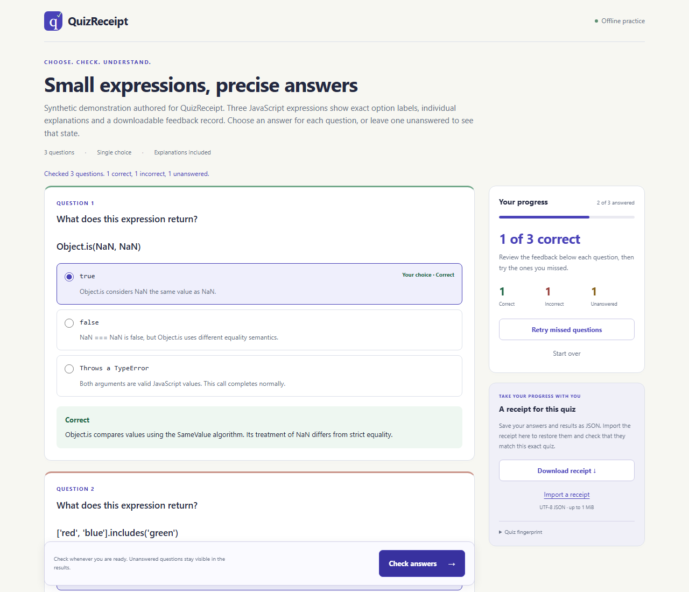

# QuizReceipt

**Turn quiz JSON into an offline lesson. Recheck its feedback against the exact quiz.**

QuizReceipt preserves literal answer labels, explains each choice, distinguishes unanswered questions, and exports a receipt that the CLI can regrade. A SHA-256 fingerprint binds the record to the quiz's complete content, including its answer key and explanations.

[Download the standalone demo](https://github.com/4onv/quizreceipt/releases/download/v0.1.0/quizreceipt-demo.html) · [Release](https://github.com/4onv/quizreceipt/releases/tag/v0.1.0) · [Schema and receipt format](docs/format.md)

Save the HTML and open it locally in a modern browser. The demonstration is synthetic, with three JavaScript questions. Try one correct answer, one incorrect answer and one unanswered question, then download its receipt.



## Build a lesson

Node.js 22+ is required for the CLI. Install the GitHub release package directly.

```sh
npm install -g https://github.com/4onv/quizreceipt/releases/download/v0.1.0/4onv-quizreceipt-0.1.0.tgz
quizreceipt demo --out lesson.html
```

For your own lesson, start from [examples/javascript.json](examples/javascript.json), then run the following commands. Each output filename must be new.

```sh
quizreceipt validate quiz.json
quizreceipt build quiz.json --out lesson.html
```

The output is a complete HTML file with embedded styles, grading logic and quiz data. Learners can check answers, inspect question and option explanations, retry missed questions, and download their feedback receipt. Changing an answer clears the old grading and disables receipt export until the answers are checked again.

## Recheck a receipt

```sh
quizreceipt verify quiz.json learner-receipt.json
quizreceipt verify quiz.json learner-receipt.json --json
```

Verification validates the receipt structure, compares its quiz ID and fingerprint, and recomputes the grading from its selections. It rejects a different quiz revision or a score, status or explanation that disagrees with those selections. Importing a receipt into its original HTML lesson performs the same verification and restores the attempt.

**Receipts are editable learning records.** Anyone who knows the answers can change the selections and recompute a consistent receipt. The answer key is embedded in the HTML. Verification establishes agreement with the supplied quiz, while identity, authorship, independent work and examination integrity require separate systems.

CLI exit codes are `0` for success, `1` for receipt verification failure and `2` for usage, file or JSON parsing errors. The CLI leaves existing output files untouched.

## Author precise questions

Each question has exactly one correct option, an explanation for the question, and an explanation for every option. Labels and prompts are plain text. Code, punctuation and whitespace stay as authored. Required explanations help an author supply useful feedback, but their factual correctness remains the author's responsibility.

```json
{
  "version": 1,
  "id": "membership-lesson",
  "title": "Array membership",
  "description": "An authored practice question.",
  "questions": [{
    "id": "includes",
    "prompt": "What does ['red'].includes('blue') return?",
    "options": [
      {"id": "yes", "label": "true", "explanation": "The array contains only red, so blue is absent."},
      {"id": "no", "label": "false", "explanation": "includes returns false for an absent value."}
    ],
    "answer": "no",
    "explanation": "includes tests membership and returns a boolean."
  }]
}
```

For an agent or another author, provide the schema and ask for exact option text with a specific reason for each answer. Review the resulting content before sharing it. QuizReceipt compiles authored data locally. [Authoring guide](docs/authoring.md)

## Use the API

```js
import { renderQuiz, createReceipt, verifyReceipt } from '@4onv/quizreceipt';

const html = await renderQuiz(quiz);
const receipt = await createReceipt(quiz, { includes: 'no' });
const checked = await verifyReceipt(quiz, receipt);
console.log(checked.grade.correct);
```

The package also exports `validateQuiz`, `canonicalQuiz`, `fingerprintQuiz`, `gradeQuiz` and the bounded `parseJson` reader. `@4onv/quizreceipt/core` works with plain data in Node and browser environments. Fingerprinting uses Web Crypto's SHA-256 implementation. [API and canonicalization contract](docs/format.md)

## Limits and privacy

- Single-choice questions, one point per correct answer, 1–50 questions and 2–6 options each.
- Canonical quiz JSON is bounded to 512 KiB. File and receipt JSON inputs are bounded to 1 MiB, with at most 24 nesting levels. Strings have individual limits documented in the schema.
- Browser state stays in memory. Save a receipt to restore an attempt later. Receipts contain selected answers and feedback, so review them before sharing.
- The HTML uses text-only rendering and a restrictive embedded Content Security Policy. It loads its application code and styles from the file itself.
- Chromium and Firefox are exercised with real file-based browser tests. Safari verification is pending. Receipt features require secure-context Web Crypto, available in the tested browsers when opening the HTML locally.
- There is no partial credit, rich HTML question content, answer randomization or identity verification in v0.1.0. Knowledge accuracy depends on the authored answer key and explanations.

## Why this project

A November 6 report requested literal technical answer choices and individual feedback from generated quizzes. We compared quiz tooling with command-argument diagnostics and PromQL change analysis before selecting this scope. [Original report](https://github.com/mattpocock/skills/issues/1392), [dated research](docs/research-2026-11-06.md)

Existing offline quiz builders already offer explanations, retries and exports. QuizReceipt's focus is a shared grading engine and an exact-content verification workflow for a portable feedback record. The research documents the substantial overlap and the reviewed alternatives. [Competitor comparison](docs/research-2026-11-06.md#existing-quiz-alternatives)

## Develop

```sh
npm ci
npm test
npm run demo
npx playwright install chromium firefox
npm run test:browser
npm pack
npm run check:package -- 4onv-quizreceipt-0.1.0.tgz
```

The runtime package has zero dependencies. Development dependencies provide browser testing. CI covers Node 22/24 on Linux and Windows and runs the generated lesson in Chromium and Firefox. The browser job uses a pinned official Playwright container image with browsers and system dependencies preinstalled.

Bug reports should include a minimal quiz, the relevant receipt if shareable, the expected behavior and the browser/Node version. Useful next work includes licensed real lesson fixtures, Safari checks and integrations that consume the verified feedback. MIT licensed.
